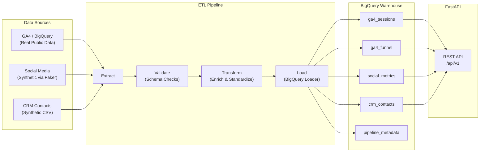

# Marketing Data Pipeline


An end-to-end ETL pipeline that unifies marketing data from Google Analytics 4, social media platforms, and CRM systems into a BigQuery data warehouse, exposed via a FastAPI REST API for analytics and attribution modeling.

---

## Problem Statement

Marketing teams typically work with data scattered across multiple platforms — web analytics in GA4, ad performance in platform-specific dashboards, and customer lifecycle data in CRM tools. This fragmentation makes it difficult to:

- **Attribute conversions** accurately across channels
- **Compare performance** between organic, paid, and direct traffic
- **Identify high-value customers** and their journey patterns
- **Allocate budgets** based on unified cross-channel metrics

This pipeline solves that by extracting data from all three sources, validating and transforming it into a consistent schema, loading it into a central BigQuery warehouse, and serving it through a REST API for dashboards, reports, and predictive models.

---

## Architecture



---

## Project Structure

```
marketing-data-pipeline/
├── config/
│   └── settings.py              # Environment config (loads from .env)
├── src/
│   ├── extractors/
│   │   ├── ga4_extractor.py     # BigQuery GA4 public dataset queries
│   │   ├── social_extractor.py  # Synthetic social media metrics
│   │   ├── crm_extractor.py     # Synthetic CRM contacts (CSV)
│   │   └── runner.py            # Runs all 3 extractors
│   ├── validators/
│   │   └── schema_validator.py  # DataFrame validation (nulls, types, ranges)
│   ├── transformers/
│   │   ├── ga4_transformer.py   # Channel grouping, conversion rates
│   │   ├── social_transformer.py # Cost metrics, efficiency scores
│   │   └── crm_transformer.py  # Engagement scores, pipeline days
│   ├── loaders/
│   │   └── bigquery_loader.py   # BigQuery table loading + metadata
│   ├── api/
│   │   ├── main.py              # FastAPI app entrypoint
│   │   ├── routes.py            # All API endpoints
│   │   ├── models.py            # Pydantic request/response schemas
│   │   └── auth.py              # API key authentication
│   └── pipeline.py              # Master ETL orchestrator
├── tests/
│   ├── test_validators.py       # 9 validation tests
│   └── test_transformers.py     # 3 transformer tests
├── data/
│   ├── raw/                     # Raw extracted data (CSV)
│   └── processed/               # Transformed data
├── .env.example                 # Environment template
├── .gitignore
├── requirements.txt
└── README.md
```

---

## API Endpoints

All authenticated endpoints require the `X-API-Key` header.

### GET /api/v1/health

Check API health and BigQuery connectivity. **No authentication required.**

```bash
curl http://localhost:8000/api/v1/health
```

```json
{
  "status": "healthy",
  "bigquery_connected": true,
  "tables_available": ["ga4_sessions", "ga4_funnel", "social_metrics", "crm_contacts"],
  "timestamp": "2025-01-15T10:30:00Z"
}
```

### GET /api/v1/metrics/daily

Query daily session metrics with optional date range and channel filter.

```bash
curl -H "X-API-Key: YOUR_API_KEY" \
  "http://localhost:8000/api/v1/metrics/daily?start_date=2021-01-01&end_date=2021-01-31&channel=paid_search"
```

```json
{
  "data": [
    {
      "date": "2021-01-01",
      "channel_grouping": "paid_search",
      "traffic_source": "google",
      "traffic_medium": "cpc",
      "unique_users": 120,
      "sessions": 150,
      "purchases": 5,
      "revenue": 500.0,
      "conversion_rate": 0.0333,
      "revenue_per_session": 3.33
    }
  ],
  "total_rows": 1,
  "start_date": "2021-01-01",
  "end_date": "2021-01-31",
  "channel_filter": "paid_search"
}
```

### GET /api/v1/channels/performance

Aggregated performance metrics grouped by channel.

```bash
curl -H "X-API-Key: YOUR_API_KEY" \
  http://localhost:8000/api/v1/channels/performance
```

```json
{
  "data": [
    {
      "channel_grouping": "organic_search",
      "total_sessions": 45200,
      "total_revenue": 125000.50,
      "total_purchases": 890,
      "avg_conversion_rate": 0.0197,
      "revenue_per_session": 2.77
    }
  ],
  "total_channels": 6
}
```

### POST /api/v1/predict/attribution

Simple linear attribution prediction from historical channel averages.

```bash
curl -X POST -H "X-API-Key: YOUR_API_KEY" \
  -H "Content-Type: application/json" \
  -d '{"channel": "paid_search", "budget": 5000, "period_days": 30}' \
  http://localhost:8000/api/v1/predict/attribution
```

```json
{
  "channel": "paid_search",
  "budget": 5000.0,
  "period_days": 30,
  "predicted_sessions": 12500,
  "predicted_revenue": 18750.0,
  "predicted_roas": 3.75,
  "confidence": "low",
  "model_type": "linear_extrapolation"
}
```

### GET /api/v1/pipeline/status

List all warehouse tables with row counts and last modified timestamps.

```bash
curl -H "X-API-Key: YOUR_API_KEY" \
  http://localhost:8000/api/v1/pipeline/status
```

```json
{
  "dataset": "marketing_warehouse",
  "tables": [
    {"table_name": "ga4_sessions", "row_count": 1250, "last_modified": "2025-01-15T10:00:00Z"},
    {"table_name": "social_metrics", "row_count": 620, "last_modified": "2025-01-15T10:00:00Z"},
    {"table_name": "crm_contacts", "row_count": 500, "last_modified": "2025-01-15T10:00:00Z"}
  ],
  "total_tables": 3,
  "total_rows": 2370
}
```

---

## Setup

### 1. Clone and create virtual environment

```bash
git clone <repository-url>
cd marketing-data-pipeline
python -m venv venv
venv\Scripts\activate        # Windows
# source venv/bin/activate   # macOS/Linux
```

### 2. Install dependencies

```bash
pip install -r requirements.txt
```

### 3. Configure environment

```bash
copy .env.example .env
```

Edit `.env` with your values:

```
GCP_PROJECT_ID=your-gcp-project-id
BQ_DATASET=marketing_warehouse
API_KEY=your-secret-api-key-here
GA4_SOURCE_TABLE=bigquery-public-data.ga4_obfuscated_sample_ecommerce.events_*
```

### 4. Authenticate with Google Cloud

```bash
gcloud auth application-default login
```

### 5. Run the ETL pipeline

```bash
python -m src.pipeline
```

### 6. Start the API server

```bash
uvicorn src.api.main:app --reload --port 8000
```

Visit `http://localhost:8000/docs` for interactive Swagger documentation.

### 7. Run tests

```bash
python -m tests.test_validators
python -m tests.test_transformers
```

---

## Data Sources

| Source | Type | Description |
|--------|------|-------------|
| **Google Analytics 4** | Real | Queries `bigquery-public-data.ga4_obfuscated_sample_ecommerce.events_*` — Google's public GA4 e-commerce dataset with real user sessions, traffic sources, and purchase events |
| **Social Media** | Synthetic | Generated via Faker with realistic per-platform profiles (Facebook, Instagram, Twitter, LinkedIn, TikTok) across 4 campaign types (awareness, consideration, conversion, retargeting) |
| **CRM** | Synthetic | 500 contacts generated with realistic funnel stage weights (30% leads tapering to 5% churned), industry distribution, and stage-appropriate deal values. Saved as CSV to `data/raw/` |

---

## Tech Stack

| Layer | Technology |
|-------|-----------|
| **Language** | Python 3.14 |
| **ETL Framework** | Custom (extractors, validators, transformers, loaders) |
| **Data Warehouse** | Google BigQuery |
| **API Framework** | FastAPI + Uvicorn |
| **Data Validation** | Custom SchemaValidator + Pydantic v2 |
| **Data Processing** | Pandas, PyArrow |
| **Synthetic Data** | Faker |
| **Authentication** | API Key via X-API-Key header |
| **Cloud SDK** | google-cloud-bigquery |

---

## Production Considerations

### Authentication & Authorization
The current API key auth is suitable for internal use. For production, consider OAuth 2.0 / JWT tokens, role-based access control (RBAC) to restrict endpoints by user role, and key rotation policies with secrets management (GCP Secret Manager, HashiCorp Vault).

### Rate Limiting
Add request rate limiting via middleware (e.g., `slowapi`) to prevent abuse and control BigQuery costs. Consider per-key quotas for different API consumers.

### CI/CD
- Run `test_validators.py` and `test_transformers.py` in CI on every PR
- Lint with `ruff` or `flake8`, type-check with `mypy`
- Build and deploy API as a Docker container to Cloud Run or GKE
- Use separate BigQuery datasets for staging vs. production

### Monitoring & Observability
- Structured logging with correlation IDs per pipeline run
- BigQuery audit logs for query costs and slot usage
- API metrics (latency, error rates, request counts) via Prometheus/Grafana or Cloud Monitoring
- Alerting on pipeline failures via the `pipeline_metadata` table

### Pipeline Scheduling
Replace manual `python -m src.pipeline` runs with Apache Airflow or Cloud Composer for scheduled, retry-capable DAGs. The pipeline's step-based architecture maps directly to Airflow tasks with proper dependency management.

### Data Quality
- Expand SchemaValidator with statistical drift detection (e.g., Great Expectations)
- Add data freshness checks — alert if tables haven't been updated within expected SLAs
- Implement incremental loading (append new data instead of full truncate) for large datasets
